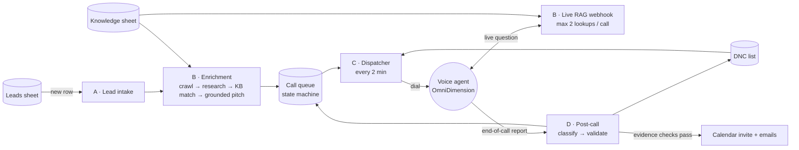

# AI Outbound Sales Caller

**A spreadsheet row in, a researched and compliant AI sales call out.** Built with n8n, OpenAI and the OmniDimension voice platform.

`3 workflow files · 80 nodes · 4 logical workflows · 1 voice agent`

## The pain point
SDR teams spend most of their day researching leads and dialling numbers that don't answer. Plugging an LLM into a dialler makes this worse in three ways:
- **It makes things up.** It invents features, prices or "results" the company can't back up.
- **It breaks calling rules.** It calls at 7 AM local time, dials twice, or ignores "please stop calling me".
- **It acts on guesses.** It books meetings the prospect never agreed to.

## What I built
A pipeline where **the model talks, but code decides.** Every claim about the company must come from an approved knowledge sheet, and every action taken from a call transcript must be backed by a verbatim quote.

| Workflow | File | What it does |
|---|---|---|
| A · Lead intake | `A-D_lead-intake-and-post-call.json` | Polls the leads sheet, normalises fields and skips leads with no phone |
| B · Enrichment & live RAG | `B_lead-enrichment-and-live-rag.json` | Crawls the prospect's site, profiles pain points, retrieves the top knowledge rows, writes a grounded pitch and queues the call. Also serves the agent's live-question webhook and team error alerts |
| C · Call dispatcher | `C_call-dispatcher.json` | The **only** component that places calls; every safety gate lives here |
| D · Post-call processing | `A-D_lead-intake-and-post-call.json` | Classifies the call, schedules retries, adds DNC numbers, books meetings and notifies the team |

## Guardrails, and why each one exists
| Risk | Guardrail (enforced in code, not in the prompt) |
|---|---|
| Inventing capabilities | The pitch agent may only use rows from the knowledge sheet; a code step re-checks that every citation matches a real retrieved row, or blanks the pitch |
| Hallucinated answers mid-call | The live-answer verifier passes an answer only if every claim's evidence is a verbatim substring of a retrieved chunk, every number appears in the evidence, and no risky terms appear (guarantee, HIPAA, SOC 2, certified…). Otherwise the agent hands off to a specialist |
| Prompt injection from scraped sites | Website text is wrapped as untrusted, the research agent is told to ignore instructions in it, and injection words are ignored during matching |
| SSRF via the crawler | Blocks localhost, private IP ranges, `.local` and `.internal`; 10 s timeout; max 5 same-site pages |
| Calling at the wrong time | Phone numbers are normalised to E.164 and the time zone is detected; calls only go out 09:00–18:00 local time (Fri/Sat weekends for Gulf time zones) |
| Double dialling | The queue row is **claimed** (status + retry count written) *before* the API call; at most one call in flight; no automatic HTTP retry; stale rows are flagged after 30 min |
| Ignoring opt-outs | The DNC list is checked before every dial; a regex for "stop calling / remove me" runs on every transcript; **DNC always wins** |
| Booking meetings nobody agreed to | A meeting is booked only if the agreed time **and** the email address are quoted verbatim in the transcript and the email is valid |
| Duplicate or late webhooks | Post-call processing only acts on rows that are currently Dispatched or Dispatching (idempotent) |
| Silent failures | API errors are classified (429 → retry in 10 min, 401/402/403 → retry in 60 min and alert, other errors → manual check), and an error workflow emails the team |

## Call queue lifecycle
`Ready to Dispatch / Awaiting Calling Window → Dispatching → Dispatched → Meeting Booked · Info Requested · Not Interested · Wrong Number · Do Not Call · retry (max 4) · Needs Manual Review`

## Run it yourself
1. Create a Google Sheet with the tabs described in [`sample/`](sample/): `Sheet1` (leads), `call Queue`, `DNC`, `Knowledge`.
2. In n8n, import the three JSON files from `workflows/`.
3. Connect your own credentials on every node marked with a warning (see `.env.example`).
4. Replace `YOUR_GOOGLE_SHEET_ID` and `https://YOUR-N8N-HOST`, and set `OMNIDIM_AGENT_ID`.
5. Point the voice agent's live tool at `POST /webhook/live-rag-query` (Header Auth) and its end-of-call webhook at `POST /webhook/omnidimension-post-call`.
6. Add 2–3 fake leads and test with your own phone number first.

See [`docs/DESIGN.md`](docs/DESIGN.md) for the AI prompts, the retrieval scoring and the known issues.

## Known limitations (being honest)
- The post-call webhook has no authentication yet. Add Header Auth before production.
- In the export, Workflow A's "Run Lead Processing" node must be re-pointed at Workflow B, with the lead fields mapped.
- Google Sheets acts as the CRM; English only; one call in flight at a time.
- DNC and calling-hour rules are built in, but this is not a full legal review of calling regulations in every country.

---
Built by **Vennela Davunuri**, AI Automation Engineer · [All my workflows](https://github.com/venneladavunuri98-cloud/n8n-ai-workflows) · [Portfolio](https://portfolio-vennela3.vercel.app) · [LinkedIn](https://www.linkedin.com/in/venneladavunuri/)
